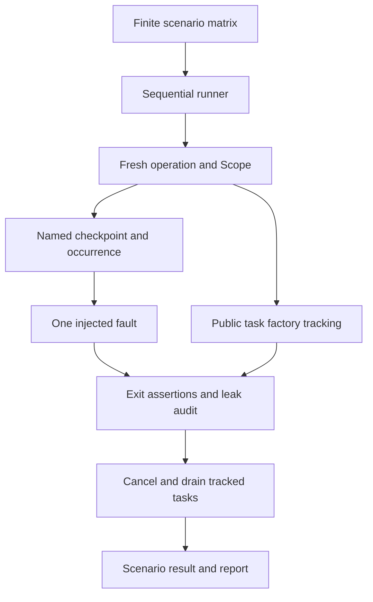

# cancelstorm

**Find the cleanup path you forgot to test.** Cancelstorm replays an async operation
against a finite matrix of named cancellation, timeout, and exception scenarios.
Every run audits state invariants, resource cleanup, and unfinished tasks.

Python **3.12+** · zero runtime dependencies · optional pytest fixture · MIT

## 30-second quickstart

From the repository root:

```bash
python -m venv .venv
. .venv/bin/activate
python -m pip install -e '.[test]'
python -m examples.payments both
python -m pytest
```

Install the library from a local checkout with `python -m pip install .`.
No PyPI publication is implied by these instructions.

```python
from cancelstorm import Storm, checkpoint, matrix


async def operation(scope):
    state = {"resource_open": False}  # NEW state on every invocation
    scope.cleanup("resource closed", lambda: not state["resource_open"])
    state["resource_open"] = True
    try:
        await checkpoint("request.sent")
    finally:
        state["resource_open"] = False


report = Storm(matrix(["request.sent"])).run(operation)
print(report)
report.assert_passed()
```

This runs a baseline plus three one-shot faults at `request.sent`.
An injected fault may propagate from the operation or be handled by it. Both are
valid if the checks pass. An unexpected exception or cancellation fails the run.
A selected checkpoint that is never reached fails, exposing stale test configuration.

## Real bug: fake payment cancellation

The demo uses in-memory accounts (100 buyer, 0 merchant), a mock authorization
service, a mock notification service, and a fake counted connection. It makes no
network calls and moves no real money.

```bash
python -m examples.payments broken
python -m examples.payments fixed
```

The broken workflow debits the buyer, pauses at `payment.after_debit`, then credits
the merchant. It rolls back and closes its connection in `except Exception`.
`asyncio.CancelledError` inherits from `BaseException`, so cancellation skips that
handler. Cancelstorm finds three cancellation failures among ten scenarios:

```text
BROKEN
7/10 scenarios passed
...
FAIL payment.after_debit#1:cancel (CancelledError)
  invariant money conserved: AssertionError: returned False
  invariant terminal phase: AssertionError: returned False
  invariant balances match phase: AssertionError: returned False
  cleanup connection closed: AssertionError: returned False
...
FIXED
10/10 scenarios passed
```

The corrected workflow puts synchronous rollback and resource release in `finally`.
The tests assert both the exact broken scenario IDs and all ten corrected outcomes.
The broken demo command succeeds when it finds the expected bug; the fixed command
fails if any corrected scenario fails. The demo is a reversible local model:
restoring Python variables cannot undo a real external payment. Real payment systems
need durable state, idempotency, reconciliation and/or compensating operations.

## Checkpoints and reproducibility

```python
from cancelstorm import Fault, Scenario, Storm, at_checkpoint, checkpoint, matrix


@at_checkpoint("gateway.authorize")
async def authorize():
    return "mock-authorization"


async def operation(scope):
    await authorize()
    for _ in range(3):
        await checkpoint("batch.item")


scenarios = matrix(
    ["batch.item"],
    occurrences=[1, 2, 3],
    faults=[Fault.CANCEL, Fault.TIMEOUT, Fault.ERROR],
)
Storm(scenarios).run(operation).assert_passed()

# Replay just the second occurrence with a custom ordinary exception:
Storm(
    [Scenario("batch.item", Fault.ERROR, occurrence=2)],
    error_factory=lambda: OSError("mock gateway unavailable"),
).run(operation).assert_passed()
```

`checkpoint(name)` is an explicit async API; `at_checkpoint(name)` is the decorator
alternative and fires before the decorated function body. Outside a storm,
checkpoints do nothing. They add no scheduling yield. Names and occurrence counts
are explicit; faults fire at most once per scenario, including during cleanup if
that is where you deliberately put a checkpoint. The operation is called afresh
for each scenario; it must recreate/reset its own mutable state and mock services.

A scenario ID is `name#occurrence:fault`, or `baseline`. Reports retain the ordered
checkpoint trace, whether injection fired, the operation outcome, all assertion
issues, and the names of unfinished tasks. `Report.results` and `Result` are frozen
records for programmatic inspection. Inputs retain their iteration order; pass
ordered sequences, not sets. Counts are per scenario across its tasks, so competing
tasks hitting the same checkpoint name need deterministic synchronization or distinct
names. This is reproducible **configuration**, not a deterministic task scheduler.
Matrices are finite materialized iterables, one fault per scenario, not a Cartesian
product of simultaneous failures.

## Invariants, cleanup and task tracking

Register assertions before the first possible fault:

```python
scope.invariant("money conserved", lambda: buyer.balance + seller.balance == 100)
scope.cleanup("socket closed", lambda: socket.closed)
```

Checks can be synchronous or async, should be observational, and may either assert
or return exactly `False` to fail; `None` means success. Every registered check runs
even if another fails. Checks observe operation exit **before harness teardown**,
so forced harness cleanup does not conceal missing application cleanup. Async checks
have the configured cooperative timeout. They must not launch detached work, mutate
state to repair a failure, or add new checkpoint injection sites.

A temporary public `loop.set_task_factory()` wrapper tracks tasks created through
`asyncio.create_task`, `loop.create_task`, `TaskGroup`, or helpers such as `gather`
that create tasks, within the operation's inherited `contextvars` context. Strong
references retain even already-completed tasks. The previous factory is delegated
to and restored, including after runner cancellation. No asyncio internals are
patched. Unrelated tasks outside the scope are not adopted. Overlapping/nested
storms on the same loop are rejected. Separate loops can run independently.

For tasks created using `asyncio.Task(...)` directly, an explicitly empty/detached
`Context`, or preexisting tasks that you want to include, use `scope.track(task)`.
The task must belong to the running loop. Keep timer callbacks, threads, processes,
async generators, transports and external resources under your own assertions;
they are not task tracking. Callbacks scheduled to create tasks **after scope exit**
are also outside the tracking window. Never replace the task factory during a run.

An unfinished tracked task fails immediately at operation exit; there is no grace
sleep that can hide a leak. Join intended background work before returning.
Harness teardown then cancels and drains tracked tasks, including descendants
spawned during cancellation, with a shared cleanup deadline. Any non-cancellation
exception in a tracked child fails conservatively, even when the application awaited
and caught it. This makes background failures visible but is deliberately stricter
than asyncio; model expected service errors inside the main operation or handle them
inside the child. In a `TaskGroup`, an `ExceptionGroup` wrapping an injected error is
reported as unexpected rather than silently exempting other grouped failures.

## pytest integration

The optional `pytest11` entry point supplies a `cancelstorm` fixture after installing
`.[test]`; no pytest-asyncio dependency is required for synchronous tests:

```python
def test_cleanup(cancelstorm):
    cancelstorm(matrix(["request.sent"])).run(operation).assert_passed()
```

For individual pytest node IDs, parametrize the explicit matrix:

```python
import pytest
from cancelstorm import Storm, matrix


@pytest.mark.parametrize("scenario", matrix(["request.sent"]), ids=lambda s: s.id)
def test_each_scenario(scenario):
    Storm([scenario]).run(operation).assert_passed()
```

Within an async test, use `report = await Storm(scenarios).arun(operation)`.
`run` refuses to nest an event loop. Cancelling `arun` propagates cancellation after
teardown instead of turning it into a successful fault-injection result.

## Architecture



Runtime code lives in `src/cancelstorm/core.py`; `pytest_plugin.py` only exposes a
fixture. `examples/payments.py` contains both workflows. Tests cover injection,
occurrence replay, missing checkpoints, invariant failures, task leaks, child
exceptions, task groups, cancellation propagation, factory restoration and the demo.

## Boundaries

- Explicit checkpoint replay **does not exhaustively explore all possible task
  scheduling interleavings**. It is not a model checker, scheduler fuzzer, deadlock
  proof, or proof that cleanup is correct everywhere.
- Cancellation injection raises `CancelledError` directly at the chosen checkpoint.
  It does **not** call `Task.cancel()`, increment `Task.cancelling()`, or simulate
  repeated cancellation, `uncancel()`, or every shield/timeout interaction. Real
  task-cancellation tests are still necessary.
- Timeout injection raises `TimeoutError` immediately; it models a timeout result,
  not elapsed wall time or the internal cancellation behavior of `asyncio.timeout`.
- The operation watchdog uses real elapsed time and is only a liveness guard, not a
  deterministic injection site. Async code must yield to let it run. Blocking code
  blocks the watchdog too.
- A task that suppresses teardown cancellation triggers `ContainmentError` and stops
  the matrix. Python cannot forcibly kill it. `asyncio.run` also waits for pending
  tasks on shutdown, so malicious/noncooperative tasks may still hang synchronous
  `run`. Use an OS-level subprocess timeout for untrusted or potentially stuck code.
- State isolation is the caller's responsibility. Reusing mutated globals, real
  services or shared persistence between runs invalidates independent replay.

See Python's documentation for [cancellation](https://docs.python.org/3.12/library/asyncio-task.html#task-cancellation)
and [public task factories](https://docs.python.org/3.12/library/asyncio-eventloop.html#asyncio.loop.set_task_factory).

## Development

```bash
python -m pip install -e '.[test]'
python -m ruff check .
python -m ruff format --check .
PYTHONASYNCIODEBUG=1 python -W error -m pytest
python -m examples.payments both
python -m build
```

CI runs Python 3.12, 3.13 and 3.14, debug-mode tests, lint, demo and distribution
build. Local validation results are recorded in `VALIDATION.md`. Runtime dependency
count is zero; the development dependencies are intentionally separate. Contributions
should include an explicit minimal scenario, expected invariant and regression test.
